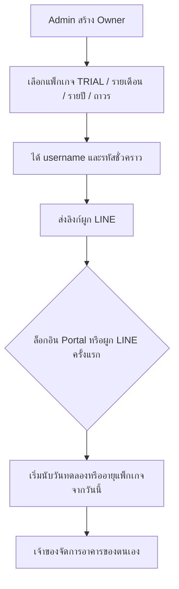
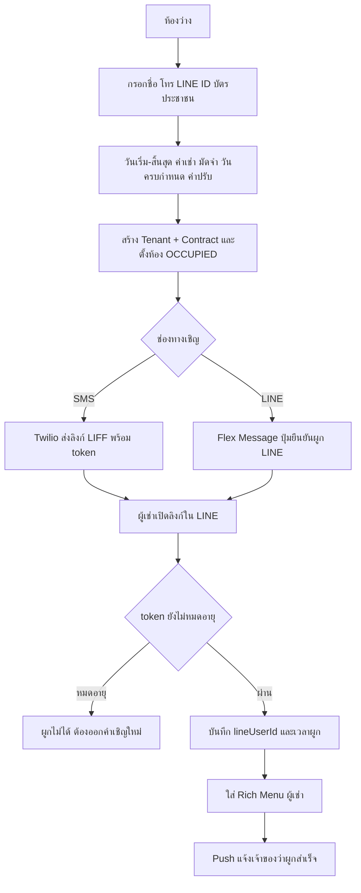
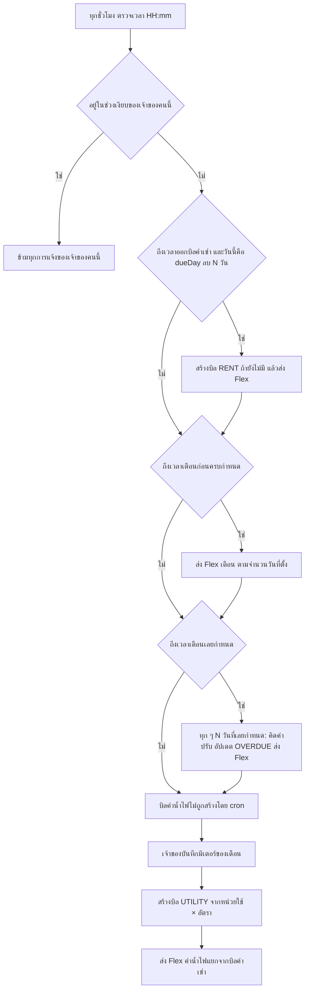
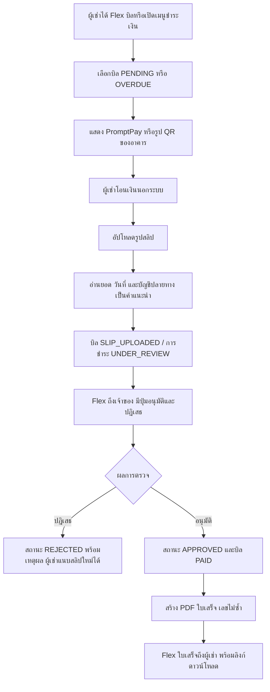
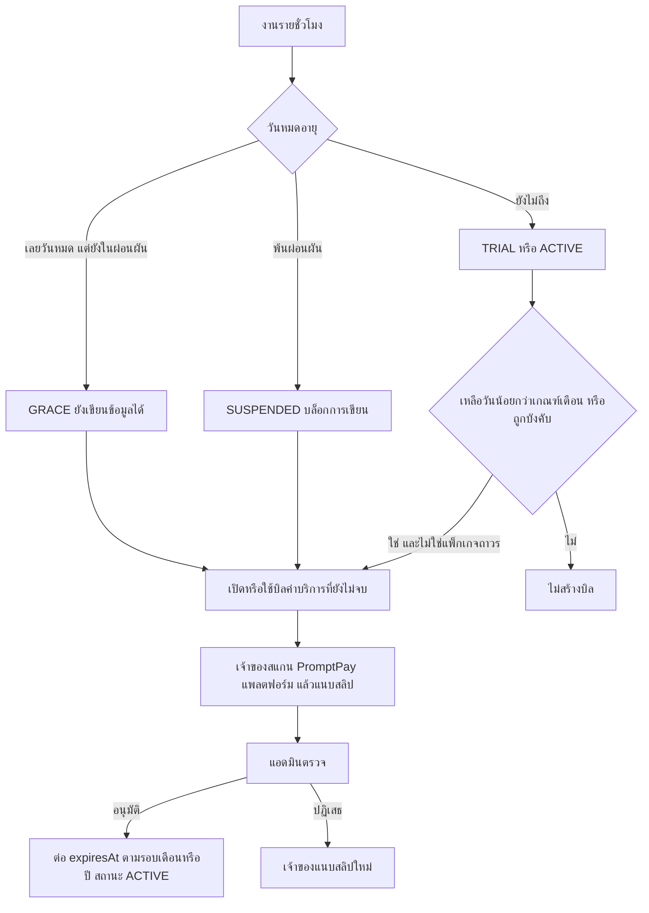
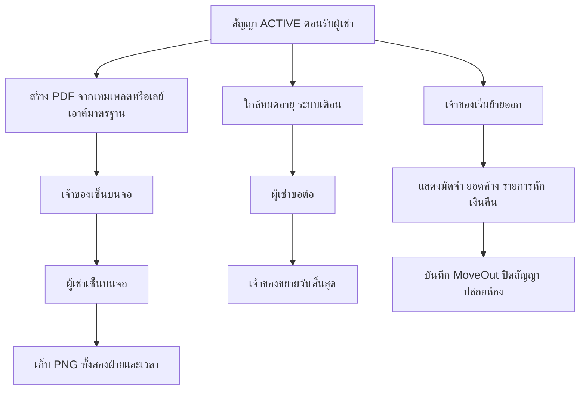
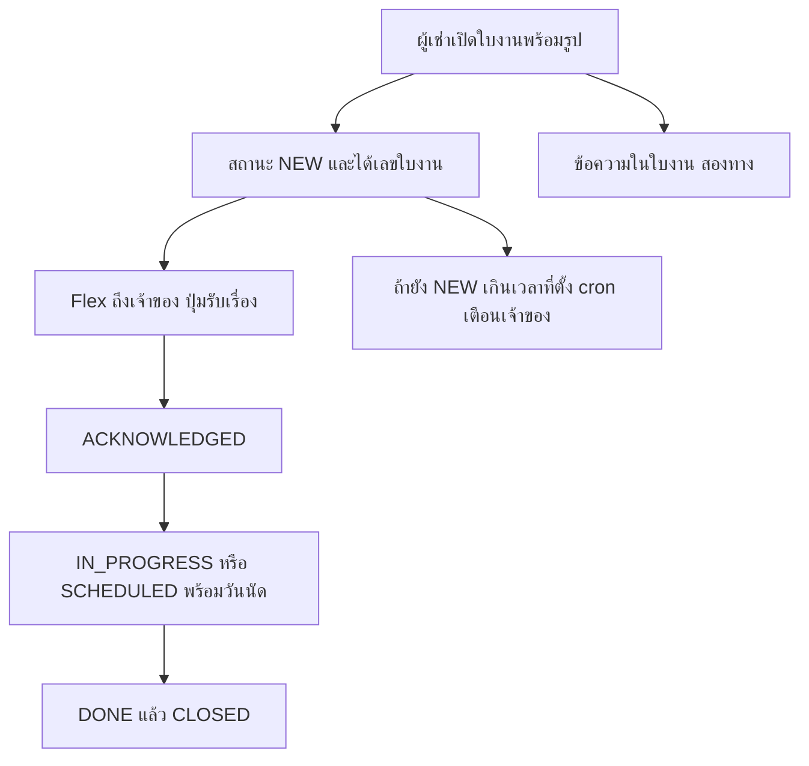
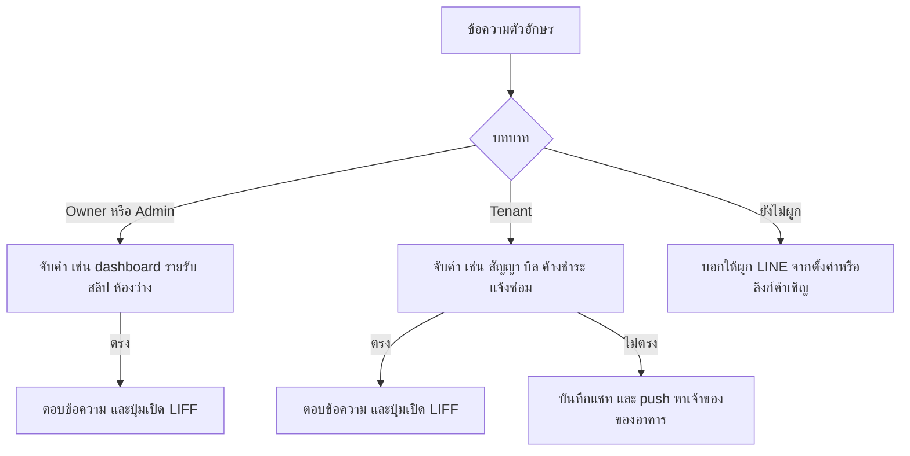
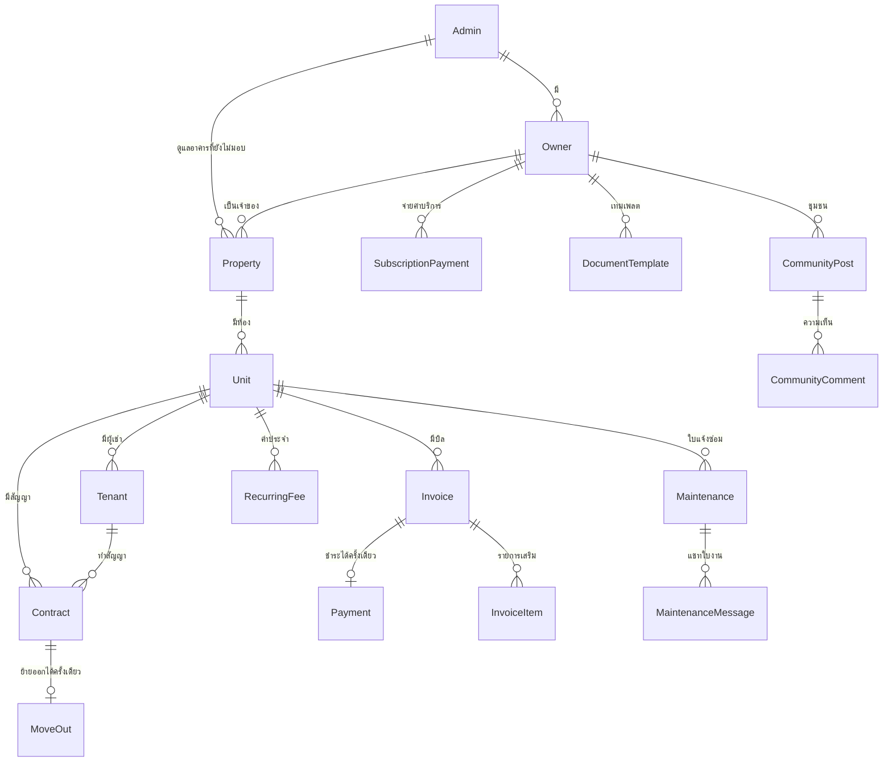

# PropFlow — รายละเอียดโปรเจกต์, SRS และ Flow ทั้งระบบ

เอกสารนี้อธิบายระบบตามโค้ดที่ใช้งานอยู่ (ไม่ใช่แค่แนวคิดตั้งต้น)  
ชื่อระบบ: **PropFlow** — ระบบจัดการบ้านเช่าผ่าน LINE และ Web Portal

| รายการ | ค่า |
|--------|-----|
| ประเภท | SaaS จัดการอสังหาริมทรัพย์ให้เช่า |
| ผู้ใช้หลัก | ผู้ดูแลแพลตฟอร์ม (Admin), เจ้าของทรัพย์สิน (Owner), ผู้เช่า (Tenant) |
| ช่องทาง | LINE OA + LIFF (มือถือ) และ Web Portal (เดสก์ท็อป) |
| ภาษา UI | ไทย |
| สถานะเอกสาร | สะท้อนโค้ดปัจจุบันใน monorepo |

---

## 1. ภาพรวมโปรเจกต์

### 1.1 เป้าหมาย

เจ้าของอสังหาฯ ที่มีหลายอาคาร/หลายห้อง จัดการผู้เช่า บิล ค่าน้ำไฟ สลิป ใบเสร็จ สัญญา แจ้งซ่อม และชุมชนลูกบ้านได้จากที่เดียว ผู้เช่าไม่ต้องมี username/password — ผูกบัญชีผ่านลิงก์คำเชิญแล้วทำธุรกรรมใน LINE

แพลตฟอร์มเองเก็บค่าบริการรายเดือน/รายปีจากเจ้าของ แยกจากค่าเช่าที่ผู้เช่าจ่ายให้เจ้าของ

### 1.2 บทบาท

| บทบาท | คือใคร | เข้าใช้ทาง | ขอบเขตข้อมูล |
|--------|--------|------------|----------------|
| **Admin** | ผู้ดำเนินการแพลตฟอร์ม | Portal `/portal/login` และ LIFF | เจ้าของทั้งหมด, บิลค่าบริการ, อาคารที่ยังไม่มอบให้เจ้าของ |
| **Owner** | เจ้าของ/ผู้จัดการทรัพย์สิน (ลูกค้าที่จ่ายค่าบริการ) | Portal และ LIFF | เฉพาะอาคารของตนเอง |
| **Tenant** | ผู้เช่า | LINE OA → LIFF เท่านั้น | เฉพาะห้องของตนเอง |
| **NEW** | LINE ที่ยังไม่ผูกบัญชี | LIFF `/link-room` | ยังไม่มีข้อมูลธุรกิจ |

ลำดับการระบุตัวตนจาก LINE user id: Admin → Tenant ที่ยัง active → Owner ที่ผูกแล้ว → NEW

### 1.3 สิ่งที่ระบบทำได้

- จัดการอาคาร ห้อง ค่าเช่า ค่าส่วนกลาง ค่าใช้จ่ายประจำ (ที่จอดรถ, wifi ฯลฯ)
- รับผู้เช่าเข้าอยู่: สร้างผู้เช่า + สัญญา + เปลี่ยนห้องเป็นมีผู้เช่า ในขั้นเดียว แล้วส่งคำเชิญ SMS หรือ LINE
- ออกบิลแยก 2 ประเภท: **ค่าเช่า** (อัตโนมัติตามวันครบกำหนด) และ **ค่าน้ำไฟ** (หลังบันทึกมิเตอร์)
- ผู้เช่าชำระด้วย PromptPay QR หรือรูป QR ของอาคาร แล้วแนบสลิป เจ้าของตรวจ/อนุมัติ ระบบออกใบเสร็จ PDF
- สัญญา: PDF, เซ็นอิเล็กทรอนิกส์ทั้งสองฝ่าย, ขอต่อสัญญา, ย้ายออกและเคลียร์เงินมัดจำ
- แจ้งซ่อม มีสถานะ แชทในใบงาน และแจ้ง LINE
- ชุมชนลูกบ้าน: ประกาศ, คุยกัน, ซื้อขายของ
- แชทใน LINE ตอบคำถามภาษาไทย (ยอดค้าง, สัญญา, dashboard) และส่งข้อความอิสระถึงเจ้าของ
- ค่าบริการแพลตฟอร์ม: ทดลองใช้, รายเดือน, รายปี, ถาวร พร้อมช่วงผ่อนผันและระงับการเขียนข้อมูล

### 1.4 สถาปัตยกรรม

```
ผู้เช่า / เจ้าของ / แอดมิน
        │
        ├─ LINE OA ──webhook──► Express /api/webhook
        │                         (follow, ข้อความ, postback)
        │
        ├─ LIFF (มือถือ, max-width ~ มือถือ)
        │     React + LINE Login
        │
        └─ Web Portal /portal  (username + password)
              React เดสก์ท็อป
                    │
                    ▼
            Express API  /api/*
                    │
        ┌───────────┼──────────────┐
        ▼           ▼              ▼
   PostgreSQL   LINE Messaging   ไฟล์ (R2 หรือดิสก์)
   (Prisma)     Flex / Rich Menu  สลิป, PDF, รูป
                    │
                    ▼
              node-cron ทุกชั่วโมง
              ออกบิล, เตือน, ค่าบริการ
```

Production รวม frontend ที่ build แล้วกับ API เป็นบริการเดียว (Railway) ไฟล์อัปโหลดควรอยู่ที่ Cloudflare R2 เพราะดิสก์ของโฮสต์ถูกรีเซ็ตทุกครั้งที่ deploy

### 1.5 เทคโนโลยี

| ชั้น | เทคโนโลยี |
|------|-----------|
| Frontend | React 18, TypeScript, Vite, Tailwind CSS, Zustand, Axios, React Router, `@line/liff` |
| Backend | Node.js, Express, TypeScript, Prisma, PostgreSQL |
| LINE | `@line/bot-sdk` — Messaging API, webhook, Rich Menu, Flex Message |
| งานตามเวลา | node-cron ทุกชั่วโมง (`0 * * * *`) |
| PDF | PDFKit + ฟอนต์ Sarabun, เทมเพลตเอกสารวางตัวแปรบนภาพพื้นหลัง |
| QR | promptpay-qr |
| SMS | Twilio (ถ้าไม่ตั้งค่า จะ log แทนการส่งจริง) |
| ไฟล์ | Cloudflare R2 หรือโฟลเดอร์ `uploads` ในเครื่อง |
| Auth | LINE Login (LIFF) และ username/password (Portal) ออกเป็น JWT |

สีหลักของ UI คือเขียว LINE `#06C755` ฟอนต์ Sarabun

---

## 2. SRS — ข้อกำหนดความต้องการซอฟต์แวร์

### 2.1 ผู้มีส่วนได้ส่วนเสีย

| รหัส | ผู้มีส่วนได้ส่วนเสีย | ความต้องการหลัก |
|------|----------------------|------------------|
| SH-1 | Admin แพลตฟอร์ม | สร้างบัญชีเจ้าของ กำหนดแพ็กเกจ อนุมัติสลิปค่าบริการ |
| SH-2 | Owner | บริหารห้อง ผู้เช่า บิล สลิป สัญญา ชุมชน โดยไม่เห็นข้อมูลเจ้าของคนอื่น |
| SH-3 | Tenant | รับบิล จ่ายเงิน ดูเอกสาร แจ้งซ่อม คุยในชุมชน ผ่าน LINE |
| SH-4 | ผู้ดำเนินการระบบ | Deploy, webhook, Rich Menu, ที่เก็บไฟล์, health check |

### 2.2 ข้อกำหนดฟังก์ชัน

รหัสขึ้นต้นด้วย FR จัดตามโมดูล สถานะทั้งหมดคือสิ่งที่ระบบทำอยู่แล้ว

#### FR-AUTH การยืนยันตัวตน

| รหัส | ข้อกำหนด |
|------|----------|
| FR-AUTH-01 | LIFF เริ่มด้วย `liff.init` ถ้ายังไม่ล็อกอินให้เรียก LINE Login แล้วส่ง access token ไป `POST /api/auth/line` |
| FR-AUTH-02 | Backend ตรวจ token กับ LINE แล้วจับคู่ `lineUserId` เป็น ADMIN, TENANT, OWNER หรือ NEW |
| FR-AUTH-03 | หลังล็อกอิน LIFF ระบบใส่ Rich Menu ตามบทบาท |
| FR-AUTH-04 | Portal ล็อกอินด้วย username/password ที่ `POST /api/auth/login` ใช้ได้เฉพาะ Admin และ Owner |
| FR-AUTH-05 | JWT เก็บในหน่วยความจำฝั่ง LIFF และในที่เก็บของเบราว์เซอร์ฝั่ง Portal (`authSource = portal`) |
| FR-AUTH-06 | ถ้า `mustChangePassword` เป็นจริง Portal บังคับไปหน้าเปลี่ยนรหัสก่อนเข้าเมนูอื่น |
| FR-AUTH-07 | มีการลงทะเบียนแอดมินและผูก LINE ของแอดมิน (`/portal/register`, `/portal/link-admin`) |
| FR-AUTH-08 | โหมดพัฒนาที่ไม่มี LIFF ID แสดงปุ่มสลับบทบาท Admin / Tenant / Owner และยอมรับ mock login |
| FR-AUTH-09 | ลิงก์ที่มี `?token=` พาไปหน้า `/link` เสมอ แม้ผู้ใช้ล็อกอินอยู่แล้ว เพื่อไม่ข้ามคำเชิญใหม่ |

#### FR-PROP อาคารและห้อง

| รหัส | ข้อกำหนด |
|------|----------|
| FR-PROP-01 | Owner/Admin สร้างอาคารได้ โดยต้องมีเลข PromptPay และใส่ธนาคาร/เลขบัญชีได้ |
| FR-PROP-02 | อาคารมีเจ้าของได้ (`ownerId`) อาคารที่ยังไม่มีเจ้าของอยู่ภายใต้การตั้งค่าแจ้งเตือนของ Admin |
| FR-PROP-03 | อัปโหลดหรือลบรูป QR รับเงินของอาคารได้ นอกเหนือจาก PromptPay ที่สร้างจากเลข |
| FR-PROP-04 | ห้องมีเลขห้อง ชั้น ค่าเช่า อัตราค่าไฟ (ค่าเริ่มต้น 5) อัตราค่าน้ำ (ค่าเริ่มต้น 18) ค่าส่วนกลาง |
| FR-PROP-05 | สถานะห้อง: ว่าง (`VACANT`), มีผู้เช่า (`OCCUPIED`), ซ่อม (`MAINTENANCE`) |
| FR-PROP-06 | ห้องมีค่าใช้จ่ายประจำหลายรายการ (ชื่อ + จำนวนเงิน) นำไปรวมในบิลค่าเช่า |
| FR-PROP-07 | แต่ละห้องมี invite token ของตนเองสำหรับผูกผู้เช่า |

#### FR-TEN ผู้เช่าและคำเชิญ

| รหัส | ข้อกำหนด |
|------|----------|
| FR-TEN-01 | `POST /api/tenants/onboard` สร้างผู้เช่าและสัญญา แล้วตั้งห้องเป็น OCCUPIED ในธุรกรรมเดียว |
| FR-TEN-02 | ห้องที่มีผู้เช่า active อยู่แล้ว ห้ามเพิ่มผู้เช่าใหม่จนกว่าจะยกเลิกสัญญาและปล่อยห้อง |
| FR-TEN-03 | สัญญาระบุวันเริ่ม วันสิ้นสุด ค่าเช่า มัดจำ ค่าปรับต่อวัน (ค่าเริ่มต้น 30) วันครบกำหนด 1–28 (ค่าเริ่มต้นวันที่ 5) และข้อความเงื่อนไข |
| FR-TEN-04 | ส่งคำเชิญทาง SMS และ/หรือ LINE Flex พร้อมลิงก์ `?token=` อายุลิงก์ 7 วัน |
| FR-TEN-05 | ผู้เช่าเปิดลิงก์แล้ว `POST /api/tenants/link` ตรวจ token ไม่หมดอายุ บันทึก `lineUserId` เวลาที่ผูก และใส่ Rich Menu ผู้เช่า |
| FR-TEN-06 | หลังผูกสำเร็จ แจ้งเจ้าของทาง LINE |
| FR-TEN-07 | Admin สร้างบัญชี Owner พร้อม username ชั่วคราว แพ็กเกจ และลิงก์ผูก LINE ของเจ้าของ |

#### FR-BILL ใบแจ้งหนี้ค่าเช่าและค่าน้ำไฟ

บิลมี 2 ประเภท แยกกัน และ unique ต่อห้อง + เดือน + ปี + ประเภท

| ประเภท | สร้างเมื่อ | รายการในบิล |
|--------|------------|-------------|
| `RENT` | อัตโนมัติ ตามวันส่งของเจ้าของ หรือกดส่งเอง | ค่าเช่าจากสัญญา + ค่าส่วนกลาง + ค่าใช้จ่ายประจำ |
| `UTILITY` | หลังมีมิเตอร์ของเดือนนั้น แล้วเจ้าของสั่งสร้าง/ส่ง | (หน่วยไฟ × อัตรา) + (หน่วยน้ำ × อัตรา) |

| รหัส | ข้อกำหนด |
|------|----------|
| FR-BILL-01 | วันครบกำหนดของบิลมาจาก `contract.dueDay` ของเดือนนั้น ไม่ใช่วันที่ 1 คงที่ |
| FR-BILL-02 | ค่าเช่าสร้างอัตโนมัติเมื่อวันนี้ = วันครบกำหนด ลบ `invoiceDaysBeforeDue` (ค่าเริ่มต้น 4 วัน) และเวลาตรง `invoiceSendTime` (ค่าเริ่มต้น 08:00) |
| FR-BILL-03 | สร้างเฉพาะห้องที่ OCCUPIED มีสัญญา ACTIVE และมีผู้เช่า active |
| FR-BILL-04 | บันทึกมิเตอร์เก็บเลขก่อน/หลัง ของไฟและน้ำ พร้อมรูปได้ |
| FR-BILL-05 | ไม่มีมิเตอร์ของเดือนนั้น จะสร้างบิลค่าน้ำไฟไม่ได้ |
| FR-BILL-06 | เจ้าของเพิ่มรายการพิเศษในบิลได้ (`extra items`) แล้วยอดรวมคำนวณใหม่ |
| FR-BILL-07 | ส่งบิลทาง LINE เป็น Flex Message พร้อมปุ่มเปิดหน้าชำระ |
| FR-BILL-08 | สถานะบิล: `PENDING`, `SLIP_UPLOADED`, `PAID`, `OVERDUE`, `CANCELLED` |
| FR-BILL-09 | เลยกำหนดชำระ ระบบคิดค่าปรับ = จำนวนวันที่เลย × `lateFeePerDay` แล้วอัปเดตยอดรวมและสถานะเป็น OVERDUE |

#### FR-PAY การชำระค่าเช่า

| รหัส | ข้อกำหนด |
|------|----------|
| FR-PAY-01 | ผู้เช่าเปิด `/pay` แล้วเลือกบิลที่ต้องจ่าย |
| FR-PAY-02 | QR ได้จาก payload PromptPay ของอาคาร หรือรูป QR ที่เจ้าของอัปโหลด |
| FR-PAY-03 | ผู้เช่าอัปโหลดสลิป `POST /api/payments/:invoiceId/slip` บิลเป็น `SLIP_UPLOADED` การชำระเป็น `UNDER_REVIEW` |
| FR-PAY-04 | ระบบอ่านสลิป (OCR) เก็บยอด วันที่ ว่าตรงยอดหรือไม่ และว่าบัญชีปลายทางตรงกับอาคารหรือไม่ ผลนี้เป็นคำแนะนำ ไม่ได้อนุมัติให้อัตโนมัติ |
| FR-PAY-05 | แจ้งเจ้าของทาง LINE ว่ามีสลิปใหม่ และตอบผู้เช่าว่ารอตรวจ |
| FR-PAY-06 | เจ้าของอนุมัติหรือปฏิเสธได้ทั้งใน LIFF และจากปุ่ม postback ใน LINE |
| FR-PAY-07 | อนุมัติแล้ว: สถานะการชำระ `APPROVED`, บิล `PAID`, สร้างเลขใบเสร็จ, สร้าง PDF, ส่ง Flex ใบเสร็จให้ผู้เช่า |
| FR-PAY-08 | ปฏิเสธแล้วเก็บเหตุผล ผู้เช่าอัปโหลดสลิปใหม่ได้ |
| FR-PAY-09 | ช่องทางเก็บเงินปัจจุบันคือ `MANUAL_SLIP` ค่า `GATEWAY` สำรองไว้สำหรับเกตเวย์ในอนาคต |

สถานะการชำระ: `WAITING_SLIP` → `UNDER_REVIEW` → `APPROVED` หรือ `REJECTED`

#### FR-SUB ค่าบริการแพลตฟอร์ม (Owner จ่ายให้ระบบ)

แยกจาก `Payment` ของค่าเช่าทั้งหมด เก็บใน `SubscriptionPayment`

| แพ็กเกจ | พฤติกรรม |
|---------|----------|
| `TRIAL` | นับวันทดลองเมื่อล็อกอินหรือผูก LINE ครั้งแรก ไม่นับตอนแอดมินสร้างบัญชี ค่าเริ่มต้น 14 วัน |
| `MONTHLY` | ใช้งานได้ตาม `SUBSCRIPTION_PERIOD_DAYS` (ค่าเริ่มต้น 30) |
| `YEARLY` | ใช้งานได้ตาม `SUBSCRIPTION_YEARLY_DAYS` (ค่าเริ่มต้น 365) |
| `PERMANENT` | ไม่มีวันหมดอายุ ไม่สร้างบิลค่าบริการ |

| รหัส | ข้อกำหนด |
|------|----------|
| FR-SUB-01 | สถานะ: `TRIAL`, `ACTIVE`, `GRACE`, `SUSPENDED` |
| FR-SUB-02 | หมดอายุแล้วยังอยู่ในช่วงผ่อนผัน (`SUBSCRIPTION_GRACE_DAYS` ค่าเริ่มต้น 7 วัน) สถานะเป็น `GRACE` ยังใช้งานได้ |
| FR-SUB-03 | พ้นช่วงผ่อนผัน สถานะเป็น `SUSPENDED` และบล็อกการเขียนข้อมูลของเจ้าของ |
| FR-SUB-04 | ระบบเปิดบิลเมื่อใกล้หมดอายุ (เตือนวันที่ 7, 3, 1) หรืออยู่ใน GRACE/SUSPENDED หรือเจ้าของกดสร้างเอง แพ็กเกจถาวรไม่ได้รับบิล |
| FR-SUB-05 | เลขบิลรูปแบบ `SUB-ปี-เลข 5 หลัก` ยอดจาก `SUBSCRIPTION_PRICE` (ค่าเริ่มต้น 499) |
| FR-SUB-06 | เจ้าของชำระด้วย PromptPay ของแพลตฟอร์ม แล้วแนบสลิป แอดมินอนุมัติแล้วต่ออายุ `expiresAt` |
| FR-SUB-07 | แจ้งเตือนและผลอนุมัติ/ปฏิเสธส่งเข้า LINE ของเจ้าของ แอดมินอนุมัติจาก LIFF, Portal หรือปุ่มใน LINE ได้ |

#### FR-DOC สัญญา ใบเสร็จ และเทมเพลต

| รหัส | ข้อกำหนด |
|------|----------|
| FR-DOC-01 | สร้าง PDF สัญญาและใบเสร็จฝั่งเซิร์ฟเวอร์ ภาษาไทยอ่านได้ |
| FR-DOC-02 | เจ้าของมีเทมเพลตเอกสารประเภท CONTRACT และ RECEIPT: อัปโหลดภาพพื้นหลัง แล้ววางตัวแปร (ชื่อ, ห้อง, ยอด, วันที่ ฯลฯ) เป็นสัดส่วน 0–1 บนหน้า |
| FR-DOC-03 | เทมเพลตเป็นค่าเริ่มต้นระดับเจ้าของ หรือเจาะจงอาคารได้ |
| FR-DOC-04 | เซ็นสัญญาอิเล็กทรอนิกส์ได้ทั้งฝั่งเจ้าของและผู้เช่า เก็บ PNG และเวลาที่เซ็น |
| FR-DOC-05 | เจ้าของอัปโหลดไฟล์สัญญาที่เซ็นแล้ว หรือลบได้ |
| FR-DOC-06 | ผู้เช่าขอยืดสัญญาได้ เจ้าของต่อสัญญาหรือยกเลิกสัญญาได้ |
| FR-DOC-07 | ย้ายออก: คำนวณมัดจำ หักยอดค้างและรายการหัก บันทึกเลขมิเตอร์สุดท้าย เงินคืน และปิดสัญญา |
| FR-DOC-08 | ผู้เช่าดูบิล ใบเสร็จ และสัญญาได้ที่หน้าเอกสารเดียว (`/documents`) |

#### FR-MAINT แจ้งซ่อม

| รหัส | ข้อกำหนด |
|------|----------|
| FR-MAINT-01 | ผู้เช่าเปิดใบงาน: หมวดไฟฟ้า / ประปา / เครื่องใช้ / ทั่วไป, หัวข้อ, รายละเอียด, รูป |
| FR-MAINT-02 | เลขใบงานไม่ซ้ำ สถานะเริ่มที่ `NEW` |
| FR-MAINT-03 | สถานะเดินได้: NEW → ACKNOWLEDGED → IN_PROGRESS → SCHEDULED → DONE → CLOSED |
| FR-MAINT-04 | แจ้งเจ้าของทันทีที่มีใบงานใหม่ และรับเรื่องจากปุ่มใน LINE ได้ |
| FR-MAINT-05 | ทั้งสองฝ่ายส่งข้อความในใบงานได้ |
| FR-MAINT-06 | ถ้าใบงานค้างสถานะ NEW เกิน `maintUnackHours` (ค่าเริ่มต้น 1 ชั่วโมง) ระบบเตือนเจ้าของ |

#### FR-CHAT LINE และการแจ้งเตือน

| รหัส | ข้อกำหนด |
|------|----------|
| FR-CHAT-01 | Webhook ตรวจลายเซ็นของ LINE ทุกคำขอ |
| FR-CHAT-02 | follow: ใส่ Rich Menu ตามบทบาท และทักทาย ถ้ายังไม่ผูกบัญชี ให้บอกให้ใช้ลิงก์คำเชิญ |
| FR-CHAT-03 | ผู้เช่าพิมพ์ภาษาไทยแล้วระบบตอบเรื่องสรุปบัญชี, สัญญา, บิล, ค้างชำระ, ชำระเงิน, ใบเสร็จ, แจ้งซ่อม, ติดต่อ |
| FR-CHAT-04 | เจ้าของ/แอดมินพิมพ์แล้วระบบตอบ dashboard, รายรับ, รายงาน, บิล, ค้างชำระ, สลิปรอตรวจ, อัตราเข้าพัก |
| FR-CHAT-05 | ข้อความผู้เช่าที่จับความหมายไม่ได้ บันทึก `ChatMessage` และ push ไปหาเจ้าของของอาคาร |
| FR-CHAT-06 | งานรายชั่วโมงเคารพช่วงเงียบ (ค่าเริ่มต้น 22:00–07:00) ของแต่ละเจ้าของ |
| FR-CHAT-07 | เตือนค่าเช่าล่วงหน้าตามจำนวนวันที่ตั้ง (ค่าเริ่มต้นเจ้าของคือ 3 และ 1 วัน) |
| FR-CHAT-08 | เตือนเลยกำหนดซ้ำทุก `overdueRepeatDays` วัน (ค่าเริ่มต้น 1) |
| FR-CHAT-09 | เตือนสัญญาใกล้หมดตามวันที่ตั้ง (ค่าเริ่มต้น 60, 30, 14, 7) ทั้งเจ้าของและผู้เช่าถ้าเปิดไว้ |
| FR-CHAT-10 | การตั้งค่าแจ้งเตือนของ Owner ใช้กับอาคารของเจ้าของคนนั้น การตั้งค่าของ Admin ใช้เฉพาะอาคารที่ยังไม่มี owner |

#### FR-COM ชุมชน

| รหัส | ข้อกำหนด |
|------|----------|
| FR-COM-01 | โพสต์อยู่ในขอบเขตเจ้าของ และกรองตามอาคารได้ |
| FR-COM-02 | ประเภท: ประกาศ (`ANNOUNCEMENT`), คุยกัน (`DISCUSSION`), ซื้อขาย (`MARKETPLACE`) |
| FR-COM-03 | ซื้อขายมีราคาและสถานะขายแล้ว แนบรูปได้สูงสุด 4 รูป |
| FR-COM-04 | เจ้าของปักหมุดหรือซ่อนโพสต์ได้ มีความคิดเห็นได้ |
| FR-COM-05 | แอดมินแพลตฟอร์มไม่เห็นแท็บชุมชนในการนำทางของ LIFF |

#### FR-RPT รายงาน

| รหัส | ข้อกำหนด |
|------|----------|
| FR-RPT-01 | Dashboard สรุปห้องเข้าพัก บิลเดือนนี้ ยอดรับแล้ว ยอดค้าง สลิปรอตรวจ |
| FR-RPT-02 | รายงานรายรับรายเดือน และส่งออกข้อมูลได้ |
| FR-RPT-03 | Portal มีหน้าภาพรวมและรายงานสำหรับ Admin/Owner |

### 2.3 ข้อกำหนดที่ไม่ใช่ฟังก์ชัน

| รหัส | ข้อกำหนด |
|------|----------|
| NFR-01 | หน้า LIFF ใช้ได้ที่ความกว้างประมาณ 360px จัดกึ่งกลางความกว้างมือถือ |
| NFR-02 | ข้อความไทยใน UI, LINE และ PDF ต้องไม่เพี้ยน (ฝังฟอนต์ Sarabun ใน PDF) |
| NFR-03 | LIFF ต้องอยู่บน HTTPS |
| NFR-04 | ข้อมูลข้ามเจ้าของห้ามรั่ว: API กรองตาม `ownerId` หรือ `adminId` ของ token |
| NFR-05 | Owner ที่สถานะ SUSPENDED เขียนข้อมูลธุรกิจไม่ได้ |
| NFR-06 | รหัสผ่านเก็บเป็นแฮช ไม่เก็บรหัสตรง |
| NFR-07 | สลิปและ PDF ที่ production เก็บนอกดิสก์ชั่วคราวของโฮสต์ |
| NFR-08 | Health check ที่ `GET /api/health` |
| NFR-09 | ถ้าไม่ตั้งค่า LINE หรือ Twilio ระบบยังรันได้ โดย log แทนการส่งจริง |
| NFR-10 | นำทาง LIFF ของ Admin กับ Owner แยกกัน: Admin ไม่เห็นบิลค่าเช่า/ชุมชน, Owner ไม่เห็นเมนูค่าบริการแพลตฟอร์มและรายชื่อเจ้าของ |

### 2.4 นอกขอบเขตปัจจุบัน

- ผู้เช่าไม่มี Portal username/password
- ยังไม่เชื่อมต่อเกตเวย์ตัดบัตรหรือหักบัญชีอัตโนมัติ (`PaymentProvider.GATEWAY` เป็นที่สำรอง)
- ไม่มีแอปมือถือนอก LINE
- OCR เป็นคำแนะนำประกอบการตรวจสลิป ไม่อนุมัติเงินให้อัตโนมัติ

---

## 3. แผนที่หน้าจอ

### 3.1 Web Portal (`/portal`) — เดสก์ท็อป

| เส้นทาง | ใครใช้ | หน้าที่ |
|---------|--------|---------|
| `/portal/login` | Admin, Owner | เข้าสู่ระบบ |
| `/portal/register` | สาธารณะตามนโยบาย | สมัครแอดมิน |
| `/portal/link-admin` | Admin | ผูก LINE ของแอดมิน |
| `/portal/change-password` | Admin, Owner | บังคับเปลี่ยนรหัสครั้งแรก |
| `/portal` | ทั้งคู่ | ภาพรวม |
| `/portal/reports` | ทั้งคู่ | รายงาน |
| `/portal/settings` | ทั้งคู่ | ตั้งค่าบัญชี |
| `/portal/subscription` | Owner | จ่ายค่าบริการแพลตฟอร์ม |
| `/portal/owners` | Admin | สร้าง/แก้/รีเซ็ตรหัส/กำหนดแพ็กเกจเจ้าของ |
| `/portal/subscriptions` | Admin | ตรวจสลิปค่าบริการ |

### 3.2 LIFF — เจ้าของและแอดมิน

แถบล่าง Owner: ภาพรวม, บิล, ชุมชน, ตั้งค่า  
แถบล่าง Admin: ภาพรวม, ค่าบริการ, เจ้าของ, ตั้งค่า

| เส้นทาง | หน้าที่ |
|---------|---------|
| `/admin/portfolio` | รายการอาคาร |
| `/admin/property/new`, `/admin/property/:id` | สร้าง/ดูอาคารและห้อง |
| `/admin/property/:id/unit/new`, `/admin/unit/:unitId` | เพิ่ม/แก้ห้อง |
| `/admin/unit/:unitId/onboard`, `/admin/tenant/:tenantId/contract` | รับผู้เช่าและตั้งสัญญา |
| `/admin/tenant/:tenantId/invite` | ส่งคำเชิญ |
| `/admin/property/:id/meter` | บันทึกมิเตอร์ |
| `/admin/invoice-builder` | สร้างและส่งบิล |
| `/admin/billing` | บิลทุกห้อง (Owner) |
| `/admin/slip/:paymentId` | ตรวจสลิป |
| `/admin/receipt/:paymentId` | ใบเสร็จ |
| `/admin/contract/:id` | ดูสัญญา |
| `/admin/contract/:id/esign` | เซ็นสัญญา |
| `/admin/contract/:id/move-out` | ย้ายออก |
| `/admin/maintenance/:id` | ใบแจ้งซ่อม |
| `/admin/notifications` | ตั้งเวลาแจ้งเตือน |
| `/admin/document-templates` | เทมเพลต PDF |
| `/admin/reports`, `/admin/settings` | รายงานและตั้งค่า |
| `/admin/owners` | จัดการเจ้าของ (Admin) |
| `/admin/subscription` | จ่ายค่าบริการ (Owner) |
| `/admin/subscriptions` | อนุมัติค่าบริการ (Admin) |
| `/community`, `/community/new`, `/community/:id` | ชุมชน |

### 3.3 LIFF — ผู้เช่า

แถบล่าง: หน้าหลัก, เอกสาร, ชุมชน, แจ้งซ่อม

Rich Menu 2 แถว × 3 ช่อง:

| ชำระเงิน `/pay` | เอกสาร `/documents` | ชุมชน `/community` |
|-----------------|----------------------|---------------------|
| แจ้งซ่อม `/maintenance/new` | ติดต่อ `/contact` | หน้าหลัก `/tenant/home` |

| เส้นทาง | หน้าที่ |
|---------|---------|
| `/link`, `/link-room`, `/link-owner`, `/link-admin` | ผูกบัญชีจาก token |
| `/tenant/home` | การ์ดบิลและทางลัด |
| `/pay`, `/payment/:invoiceId`, `/payment/:invoiceId/qr` | เลือกบิลและแสดง QR |
| `/payment/:invoiceId/success` | แนบสลิปสำเร็จ |
| `/documents` | บิล ใบเสร็จ สัญญา |
| `/contract/:id`, `/contract/:id/esign` | ดูและเซ็นสัญญา |
| `/tenant/maintenance`, `.../new`, `.../:id` | รายการ เปิดใบงาน รายละเอียด |
| `/tenant/profile` | ติดต่อเจ้าของ |
| `/pdf-viewer` | เปิด PDF |

### 3.4 Rich Menu ของผู้จัดการ

Owner (4 ช่อง): ภาพรวม, บิล, ชุมชน, ตั้งค่า  
Admin (4 ช่อง): ภาพรวม, ค่าบริการ, เจ้าของ, ตั้งค่า

---

## 4. Flow ทั้งระบบ

### 4.1 เข้าสู่ระบบ

```mermaid
flowchart TD
  start[เปิดแอป] --> channel{ช่องทาง}
  channel -->|LINE / LIFF| liff[liff.init และ LINE Login]
  channel -->|เบราว์เซอร์ /portal| portal[กรอก username และ password]
  liff --> verify[ตรวจ access token กับ LINE]
  verify --> role{จับคู่ lineUserId}
  portal --> pwd{รหัสถูก และเป็น Admin หรือ Owner}
  pwd -->|ไม่ผ่าน| deny[ปฏิเสธ]
  pwd -->|ผ่าน| jwtP[ออก JWT แหล่ง portal]
  role -->|Admin| menuA[Rich Menu แอดมิน → ภาพรวม]
  role -->|Tenant active| menuT[Rich Menu ผู้เช่า → หน้าหลัก]
  role -->|Owner ที่ผูกแล้ว| trial[เริ่มนาฬิกาทดลองถ้ายังไม่เริ่ม]
  trial --> menuO[Rich Menu เจ้าของ → ภาพรวม]
  role -->|ไม่พบ| newUser[บทบาท NEW → หน้าผูกห้อง]
  jwtP --> must{ต้องเปลี่ยนรหัส}
  must -->|ใช่| chg[/portal/change-password]
  must -->|ไม่| homeP[Portal ภาพรวม]
```

ถ้า URL มี `token` ระบบพาไป `/link` ก่อน แล้วแยกชนิดคำเชิญเป็นผู้เช่า เจ้าของ หรือแอดมิน

### 4.2 เปิดบัญชีเจ้าของ



วันทดลองไม่เริ่มตอนกดสร้างบัญชี เพื่อไม่ให้วันหมดระหว่างที่เจ้าของยังไม่ได้รับรหัส

### 4.3 รับผู้เช่าเข้าอยู่



### 4.4 รอบบิลรายเดือน



ตัวอย่าง: สัญญากำหนดชำระวันที่ 5 และตั้งส่งล่วงหน้า 4 วัน เวลา 08:00 ระบบสร้างบิลค่าเช่าวันที่ 1 เวลา 08:00 ของรอบนั้น

งานเดียวกันยังเตือนสัญญาใกล้หมดอายุ และใบแจ้งซ่อมที่ไม่มีคนรับเรื่อง

### 4.5 ผู้เช่าชำระเงินจนได้ใบเสร็จ



อนุมัติจากหน้า LIFF กับจากปุ่มในแชท เรียกบริการเดียวกัน

### 4.6 ค่าบริการแพลตฟอร์ม



### 4.7 สัญญา เซ็น และย้ายออก



### 4.8 แจ้งซ่อม



### 4.9 แชทใน LINE



คำที่ผู้เช่าใช้ได้: สรุปข้อมูล, สัญญา, ค้างชำระ, บิล, ชำระเงิน, ใบเสร็จ, แจ้งซ่อม, ติดต่อ, ช่วยเหลือ  
คำที่ผู้จัดการใช้ได้: dashboard, รายได้, รายงาน, บิล, ค้างชำระ, สลิป, ห้องว่าง, ช่วยเหลือ

ปุ่ม postback ใน Flex: `APPROVE_PAYMENT`, `REJECT_PAYMENT`, `APPROVE_SUB`, `REJECT_SUB`, `ACK_MAINTENANCE`

### 4.10 ชุมชน

ผู้เช่าหรือเจ้าของสร้างโพสต์ในอาคารของตน → แสดงในฟีด → ความคิดเห็นได้ → เจ้าของปักหมุดหรือซ่อนได้ → โพสต์ซื้อขายกดขายแล้วได้

---

## 5. โมเดลข้อมูลหลัก



ความสัมพันธ์ที่ต้องจำ:

- หนึ่งบิลมีการชำระได้หนึ่งรายการ (`Payment.invoiceId` unique)
- หนึ่งห้องในหนึ่งเดือนมีบิลค่าเช่าได้หนึ่งใบ และบิลค่าน้ำไฟได้หนึ่งใบ
- อาคารอยู่ใต้ Admin เสมอ และอาจมี Owner เพิ่ม
- ค่าบริการแพลตฟอร์มไม่ปนกับสลิปค่าเช่า

---

## 6. API หลัก

ทุกเส้นทางธุรกิจอยู่ใต้ `/api` ยกเว้นไฟล์ static และหน้าเว็บ

| กลุ่ม | เมธอดและเส้นทาง | ใช้ทำอะไร |
|--------|------------------|-----------|
| สุขภาพ | `GET /api/health` | ตรวจว่าเซิร์ฟเวอร์ตอบ |
| Auth | `POST /api/auth/line` | ล็อกอิน LIFF |
| Auth | `POST /api/auth/login` | ล็อกอิน Portal |
| Auth | `POST /api/auth/register-admin` | สมัครแอดมิน |
| Auth | `POST /api/auth/password` | เปลี่ยนรหัส |
| Auth | `GET /api/auth/me` | ข้อมูลผู้ใช้ปัจจุบัน |
| คำเชิญ | `GET /api/invite/info` | ดูชนิด token ก่อนผูก |
| อาคาร | `GET/POST /api/properties`, `PUT/DELETE /api/properties/:id` | CRUD อาคาร |
| อาคาร | `POST/DELETE /api/properties/:id/payment-qr` | รูป QR รับเงิน |
| ห้อง | `GET/POST /api/properties/:id/units` | รายการและเพิ่มห้อง |
| ห้อง | `PUT/DELETE /api/units/:id` | แก้หรือลบห้อง |
| ห้อง | `POST /api/units/:id/fees` | ค่าใช้จ่ายประจำ |
| เจ้าของ | `GET/POST /api/owners`, `PUT /api/owners/:id` | บัญชีเจ้าของ (Admin) |
| เจ้าของ | `POST /api/owners/link` | ผูก LINE เจ้าของ |
| ผู้เช่า | `POST /api/tenants/onboard` | รับเข้าอยู่ |
| ผู้เช่า | `POST /api/tenants/link` | ผู้เช่าผูก LINE |
| ผู้เช่า | `POST /api/tenants/:id/invite/sms` และ `.../line` | ส่งคำเชิญ |
| สัญญา | `GET /api/contracts/me`, `GET /api/contracts/:id` | ดูสัญญา |
| สัญญา | `POST /api/contracts/:id/pdf` | สร้าง PDF |
| สัญญา | `POST /api/contracts/:id/esign` | เซ็น |
| สัญญา | `POST /api/contracts/:id/renew-request`, `PUT /api/contracts/:id/renew` | ขอต่อและต่อสัญญา |
| สัญญา | `POST /api/contracts/:id/move-out` | บันทึกย้ายออก |
| มิเตอร์ | `POST /api/meters`, `GET /api/meters/:unitId` | บันทึกและดูมิเตอร์ |
| บิล | `POST /api/invoices`, `POST /api/invoices/:id/send` | สร้างและส่ง |
| บิล | `POST /api/invoices/send-all` | ส่งทั้งชุด |
| บิล | `PUT /api/invoices/:id/extra-items` | รายการเสริม |
| ชำระ | `GET /api/payments/:invoiceId/qr` | payload QR |
| ชำระ | `POST /api/payments/:invoiceId/slip` | อัปโหลดสลิป |
| ชำระ | `POST /api/payments/:paymentId/approve` และ `.../reject` | ตรวจสลิป |
| ชำระ | `GET /api/payments/:paymentId/receipt/pdf` | ใบเสร็จ |
| ค่าบริการ | `GET /api/subscriptions/me`, `POST /api/subscriptions/me/bill` | สรุปและเปิดบิล |
| ค่าบริการ | `POST /api/subscriptions/:id/slip` | แนบสลิปค่าบริการ |
| ค่าบริการ | `POST /api/subscriptions/:id/approve` และ `.../reject` | แอดมินตรวจ |
| เทมเพลต | `GET/POST /api/document-templates` | รายการและสร้าง |
| ชุมชน | `GET/POST /api/community/posts` | ฟีดและโพสต์ |
| เอกสารผู้เช่า | `GET /api/documents` | รวมบิล ใบเสร็จ สัญญา |
| ซ่อม | `POST/GET /api/maintenance`, `PUT /api/maintenance/:id/status` | ใบงาน |
| แจ้งเตือน | `GET/PUT /api/notifications/settings` | ค่าเวลาส่ง |
| รายงาน | `GET /api/reports/dashboard`, `/revenue`, `/export` | ตัวเลขและส่งออก |
| LINE | `POST /api/webhook` | เหตุการณ์จาก LINE |

---

## 7. งานตามเวลา

รันนาทีที่ 0 ของทุกชั่วโมง ตามเขตเวลาของเซิร์ฟเวอร์

ลำดับในหนึ่งรอบ:

1. งานค่าบริการ: ปรับสถานะทดลอง/ใช้งาน/ผ่อนผัน/ระงับ และส่งเตือนตาม `SUBSCRIPTION_REMIND_TIME` (ค่าเริ่มต้น 09:00) ที่วัน 7, 3 และ 1 ก่อนหมด
2. วนทุก Owner ถ้าถึงช่วงเงียบให้ข้ามคนนั้น ไม่เช่นนั้นทำตามเวลาที่เจ้าของตั้ง: ออกบิลค่าเช่า, เตือนก่อนครบกำหนด, เตือนเลยกำหนด, เตือนสัญญา, เตือนใบซ่อมค้าง
3. วนทุก Admin ด้วยชุดการตั้งค่าของแอดมิน แต่เฉพาะอาคารที่ `ownerId` ว่าง

ค่าเริ่มต้นที่สำคัญของเจ้าของ:

| รายการ | ค่าเริ่มต้น |
|--------|-------------|
| ส่งบิลก่อนครบกำหนด | 4 วัน เวลา 08:00 |
| เตือนค่าเช่า | 3 วัน และ 1 วัน เวลา 08:00 |
| เตือนเลยกำหนด | ทุก 1 วัน เวลา 09:00 |
| เตือนสัญญา | 60, 30, 14, 7 วัน เวลา 08:00 แจ้งผู้เช่าด้วย |
| ใบซ่อมไม่มีคนรับ | 1 ชั่วโมง |
| ช่วงเงียบ | 22:00–07:00 |

---

## 8. การ deploy และการตั้งค่า

รัน local: PostgreSQL จาก Docker Compose, backend พอร์ต 4000, frontend พอร์ต 5173  
Production: Dockerfile รวมไฟล์เว็บกับ API, migrate ตอนสตาร์ท, health check `/api/health`

ตัวแปรที่ระบบพึ่งพา:

| กลุ่ม | ตัวแปร |
|--------|--------|
| ฐานข้อมูล | `DATABASE_URL` |
| JWT | `JWT_SECRET`, `JWT_EXPIRES_IN` |
| LINE OA | `LINE_CHANNEL_ID`, `LINE_CHANNEL_SECRET`, `LINE_CHANNEL_ACCESS_TOKEN` |
| LINE Login / LIFF | `LINE_LOGIN_CHANNEL_ID`, `LIFF_ID`, `LIFF_BASE_URL`, `VITE_LIFF_ID`, `VITE_API_URL` |
| URL | `FRONTEND_URL`, `BACKEND_URL`, `PORT` |
| ไฟล์ | `R2_ACCOUNT_ID`, `R2_ACCESS_KEY_ID`, `R2_SECRET_ACCESS_KEY`, `R2_BUCKET` |
| SMS | `TWILIO_ACCOUNT_SID`, `TWILIO_AUTH_TOKEN`, `TWILIO_FROM_NUMBER` |
| ค่าบริการ | `PLATFORM_PROMPTPAY_NUMBER`, `SUBSCRIPTION_PRICE`, `SUBSCRIPTION_PERIOD_DAYS`, `SUBSCRIPTION_YEARLY_DAYS`, `SUBSCRIPTION_TRIAL_DAYS`, `SUBSCRIPTION_GRACE_DAYS`, `SUBSCRIPTION_REMIND_DAYS`, `SUBSCRIPTION_REMIND_TIME` |

หลัง deploy ต้องชี้ webhook ของ LINE มาที่ `https://<โฮสต์>/api/webhook` และตั้ง LIFF endpoint เป็น URL เดียวกันของแอป

---

## 9. เกณฑ์ตรวจรับตาม flow

| Flow | ผ่านเมื่อ |
|------|-----------|
| ล็อกอิน | Admin เข้าภาพรวม, Owner เข้าภาพรวมของตน, Tenant เข้าหน้าหลัก, คนใหม่ไปหน้าผูกบัญชี |
| คำเชิญ | ลิงก์เปิดใน LINE แล้ว Rich Menu ผู้เช่าขึ้น และเจ้าของได้รับข้อความผูกสำเร็จ |
| บิลค่าเช่า | ถึงวันและเวลาที่ตั้งแล้วมีบิล RENT และ Flex ถึงผู้เช่าที่ผูก LINE |
| บิลน้ำไฟ | ไม่มีมิเตอร์แล้วสร้างไม่ได้ มีมิเตอร์แล้วยอดตรงกับหน่วยคูณอัตรา |
| สลิป | รูปไปถึงหน้าตรวจของเจ้าของ อนุมัติแล้วผู้เช่าได้ใบเสร็จที่ตัวอักษรไทยไม่แตก |
| ช่วงเงียบ | ในช่วงที่ตั้งไว้ ไม่มีข้อความบิลหรือเตือนออก |
| ค่าบริการ | ทดลองเริ่มตอนใช้งานครั้งแรก หมดอายุแล้วเข้า GRACE แล้ว SUSPENDED และแพ็กเกจถาวรไม่มีบิล |
| แยกบทบาท | Owner ไม่เห็นเมนูค่าบริการของแพลตฟอร์มและรายชื่อเจ้าของคนอื่น Admin ไม่เห็นแท็บบิลค่าเช่าและชุมชน |
| ย้ายออก | เงินคืนเท่ากับมัดจำหักยอดค้างและรายการหัก และห้องกลับมาเพิ่มผู้เช่าใหม่ได้ |
